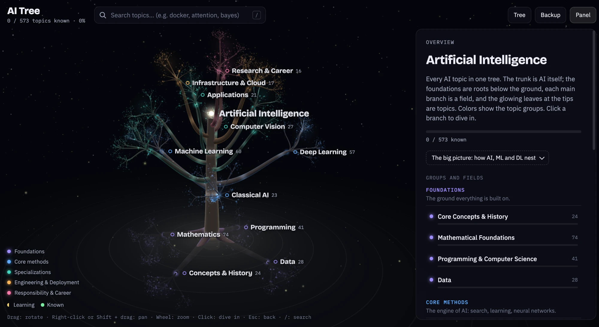

# AI Learning Tree



A personal learning map that shows 18 fields and 573 topics of artificial intelligence as an
interactive 3D tree. The trunk is AI itself; the foundations (math, programming, data) are
the roots below the ground, the other fields are branches growing from the trunk, and the
topics are glowing leaves at the tips.

- Mark topics as **Learning** or **Known**: known leaves glow, the ones you are learning pulse.
- Every topic has a short description and a plain-language “simple explanation”.
- Take notes per topic; they save automatically.
- Search across all topics (`/`).
- Progress and notes are saved automatically to a small SQLite database in the project folder (see below); export/import them as JSON from **Data**.

Built with plain HTML, ES modules and [Three.js](https://threejs.org/) (0.128, loaded from a CDN), plus a dependency-free Node server for saving progress. No build step.

## Running it

You need [Node.js](https://nodejs.org/) 18 or newer. From the project folder:

```bash
npm run dev
```

Then open http://localhost:5173. There is nothing to install: `server.mjs` uses only what
ships with Node.

## Where your progress is saved

`npm run dev` starts a small local server that serves the site **and saves your progress in a
SQLite database inside the project**: `data/progress.db`. It saves automatically after every
change; the badge in the top bar shows *Saved*, *Saving…* or *Not saved*.

- Nothing leaves your computer. The server only listens on `localhost`, and `data/` is in
  `.gitignore`, so your progress is never committed.
- Progress you already had in the browser moves into the database the first time you run it.
- Node 22.13+ uses its built-in SQLite. Older Node versions fall back to `data/progress.json`.
- Want the same progress on two computers? Keep the data in a synced folder:
  `DATA_DIR=~/Dropbox/ai-tree npm run dev`. Use `PORT=8080 npm run dev` for another port.
- **Data** in the top bar exports everything as a JSON file and imports it again.

Without Node, `python3 -m http.server 5173` works too, but then progress is only kept in the
browser's `localStorage`.

Check the content with `npm run check`.

## Database

| Table | Contents |
| --- | --- |
| `status` | status per topic (1 learning, 2 known/learned, 3 skipped) and when it changed |
| `notes` | your note per topic |
| `checks` | ticked checklist items (AI Roadmap) |
| `status_log` | every status change with a timestamp, for a future progress chart |
| `meta` | small settings (e.g. whether the intro was shown) |

You can open it with any SQLite tool, e.g. `sqlite3 data/progress.db "select * from status_log"`.

## Controls

| Action | Input |
| --- | --- |
| Rotate | Drag |
| Pan | Right-click drag or Shift + drag |
| Zoom | Mouse wheel |
| Open a branch / topic | Click |
| Go back | Esc |
| Search | `/` |

## Project layout

- `src/` code (module map in `CLAUDE.md`)
- `content/` topics, one file per field (format in `docs/CONTENT_FORMAT.md`)
- `docs/ROADMAP.md` planned work, in small steps
- `server.mjs` local server and progress database
- `scripts/check-content.mjs` content checker

## Developing with Claude Code

`CLAUDE.md` describes the structure and the rules of the project; Claude Code reads it at the
start of every session. Pick items from `docs/ROADMAP.md` one at a time, check the result in
the browser, and commit after each step.
